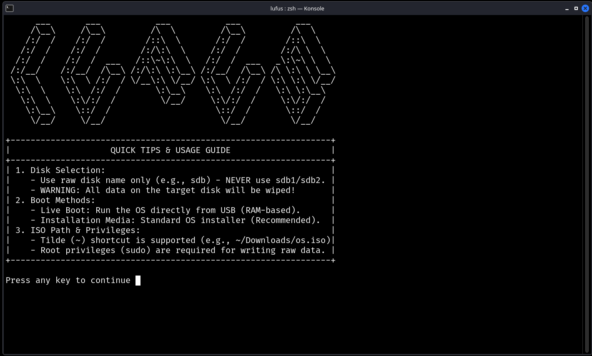

# Lufus
<p align="center">
  
</p>
Lufus is a lightweight and simple bash script designed to create bootable USB drives on Linux systems. 

The main goal of this project is ease of use. It provides a straightforward way to flash ISO images to USB disks without dealing with complex command-line options.

## Features

- Interactive terminal user interface (TUI)
- Drive validation to prevent selecting system partitions
- Simple and fast ISO flashing process

## How to Use

1. Clone or download the repository.
2. Run the installer script with root privileges:
```bash
   sudo ./lufus-installer.sh
   
